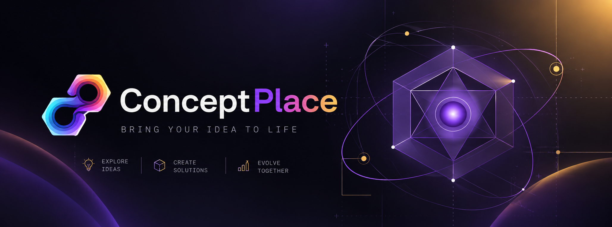

# Concept Place

> An AI workspace for founders to explore ideas, test assumptions, and launch their first campaign.

<p align="center">
  
</p>

[](https://www.conceptplace.in/)


Built by Grow Millions Private Limited in India.

## About

Concept Place brings business chat, marketing planning, content drafts, campaign calendars, startup scenario analysis, and automation discovery into one connected workspace. Its purpose is to help founders test ideas, understand the assumptions behind them, and move toward practical next steps with more clarity.

## Preview

<p align="center">
  
</p>

<p align="center">
  
</p>

## Features

| Feature | What it helps with |
| --- | --- |
| **MARK AI** | Ask business questions, get practical advice, and ask follow-up questions. Use Normal mode for focused answers and Duo mode to compare trade-offs. |
| **Marketing Strategist** | Turn an offer and audience into a marketing plan and campaign direction. |
| **Content Generator** | Create editable text and storyboard drafts. It does not currently create finished images or videos. |
| **Content Calendar** | Organize campaign posts; filter by date or platform. |
| **Auto Post** | Prepare posts and schedules for supported connected social accounts. You review and approve content before publication. |
| **Oasis Discovery** | A business scenario simulator that helps founders explore how pricing, costs, demand, and customer-acquisition assumptions can affect cash flow and profitability. Use it to test whether assumptions are viable before committing resources. |
| **Automation Marketplace** | Find ready-made workflows for follow-ups and everyday operations. Some require external accounts or separate purchase. |
| **Compliance** | Track India-focused incorporation milestones and business tasks in a practical checklist. |

## How to use Concept Place

1. Visit [conceptplace.in](https://www.conceptplace.in/) and start free. The free plan currently includes 50 AI credits each month with no card required.
2. Tell MARK AI what you are building, where you are today, and the decision you need to make.
3. Build a marketing plan, draft content, or explore assumptions behind the business.
4. Use Oasis Discovery to test assumptions such as pricing, costs, demand, or customer acquisition cost.
5. Review the facts and edits so they fit your audience.
6. Organize your next step in Content Calendar, review a publishing schedule, or discover an automation.
7. Run a small real-world experiment, record what you learn, and refine the plan.

## Important notes

- Scenario results depend on the assumptions you enter. They are exploration tools, not guaranteed forecasts.
- Social availability depends on platform permissions, account type, and supported formats.
- Important financial, legal, and compliance decisions should be checked with qualified professionals.
- The product is being built in phases, and early-access feedback shapes what comes next.

## Explore

- [Start with MARK AI](https://www.conceptplace.in/mark-ai-new)
- [Open Marketing Strategist](https://www.conceptplace.in/marketing-strategist)
- [Explore Content Calendar](https://www.conceptplace.in/content-calendar)
- [Explore Auto Post](https://www.conceptplace.in/auto-post)
- [Discover Oasis](https://www.conceptplace.in/oasis-discovery)
- [Explore Automation Marketplace](https://www.conceptplace.in/automation-market-place)
- [Explore Compliance](https://www.conceptplace.in/compliance)
- [Contact Grow Millions](https://www.conceptplace.in/contact)

---

## MARK AI Backend

This repository also contains the serverless backend source for MARK AI workflows, built with AWS SAM, AWS Lambda, Amazon API Gateway, and Python.

| Path | Purpose |
| --- | --- |
| `hello_world/` | Lambda function source code. |
| `events/` | Sample invocation events. |
| `tests/` | Unit and integration tests. |
| `template.yaml` | SAM infrastructure template. |

### Build and deploy

Install the [AWS SAM CLI](https://docs.aws.amazon.com/serverless-application-model/latest/developerguide/serverless-sam-cli-install.html), Python 3, Docker, and configure AWS credentials.

```bash
sam build --use-container
sam deploy --guided
```

### Test locally

```bash
sam local invoke HelloWorldFunction --event events/event.json
sam local start-api
curl http://localhost:3000/
python -m pytest tests/unit -v
```

See the [AWS SAM Developer Guide](https://docs.aws.amazon.com/serverless-application-model/latest/developerguide/what-is-sam.html) for more details.

---

<p align="center">Built for founders who want to test, learn, and launch with clarity.</p>
